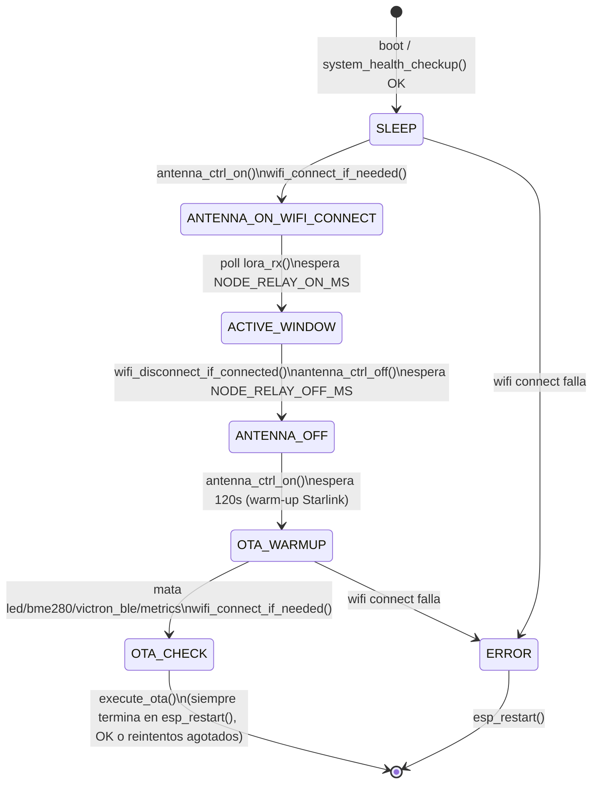
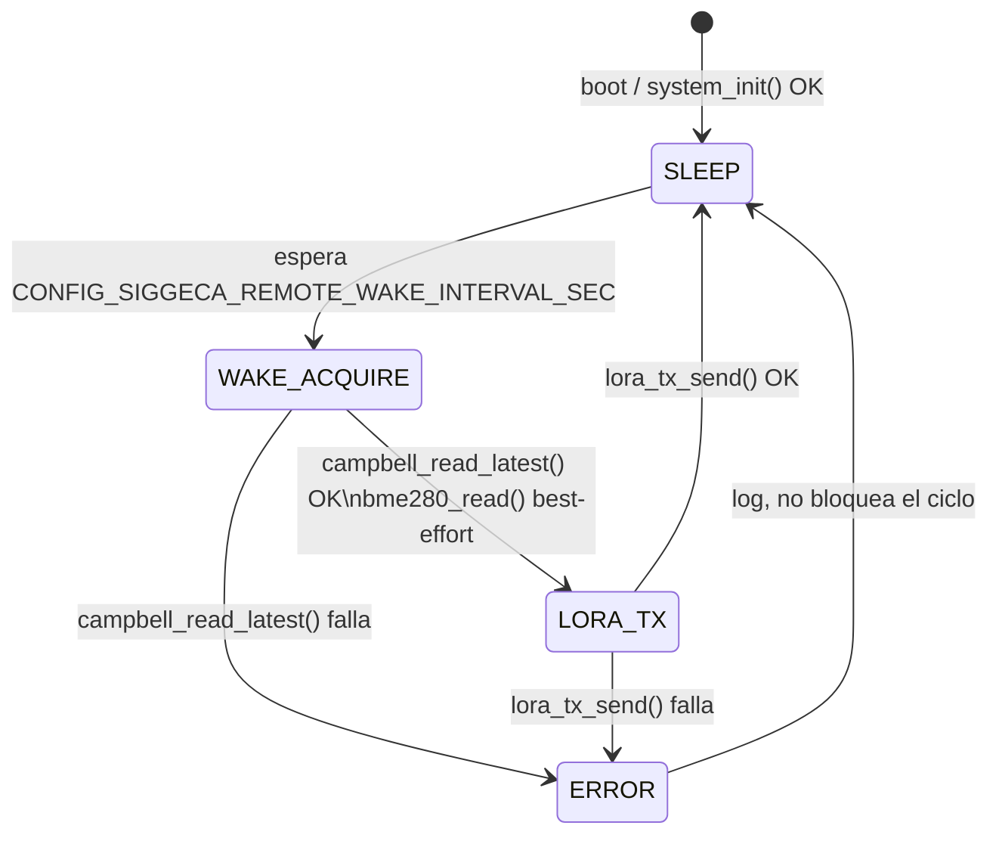

# Máquinas de estado

Diagramas en Mermaid (renderizan directo en GitHub) de las dos FSM del
firmware. Se generan a mano a partir del código -- si cambia
`gateway_fsm.c`/`remote_fsm.c`, actualizar este archivo en el mismo commit
para que no se desincronicen (el mismo problema de drift documentado en
`node_config.h` para la config de sitio).

## Gateway (`gateway/main/src/gateway_fsm.c`)

Notas:
- `execute_ota()` **siempre** reinicia el equipo (éxito o reintentos
  agotados), así que la FSM no vuelve a `SLEEP` sola -- el próximo ciclo
  arranca en el boot siguiente. Por eso `OTA_CHECK` y `ERROR` van a `[*]`
  en vez de tener una transición saliente real.
- `NODE_RELAY_ON_MS`/`NODE_RELAY_OFF_MS` salen de Kconfig
  (`node_config.h`), no están hardcodeados en la FSM.
- El polling de `lora_rx()` durante `ANTENNA_ON_WIFI_CONNECT` es el gancho
  para cuando el driver LoRa esté implementado (hoy el stub nunca devuelve
  paquetes).

## Nodo remoto (`remote/main/src/remote_fsm.c`)

Notas:
- A diferencia del gateway, acá `ERROR` **no** reinicia el equipo -- vuelve
  a dormir y reintenta en el próximo ciclo (mismo criterio que "si no hay
  conexión, apagar igual" de la campaña anterior).
- `bme280_read()` es best-effort: si falla, igual se manda el dato de
  Campbell (no se descarta el ciclo entero por el sensor local).
- `SLEEP` es un `vTaskDelay`, no `esp_deep_sleep_start()` -- ver el
  comentario en `remote_fsm.h` sobre por qué (todavía no hace falta el
  ahorro de energía real de un deep sleep).
