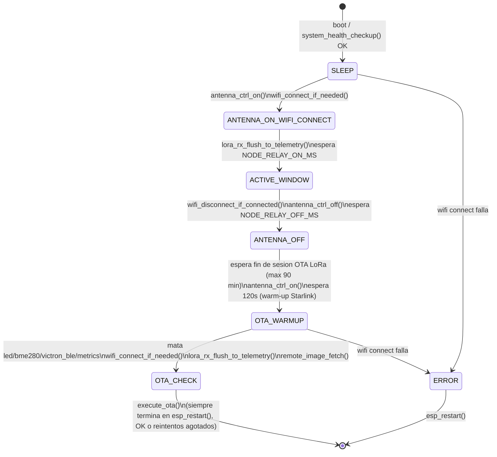
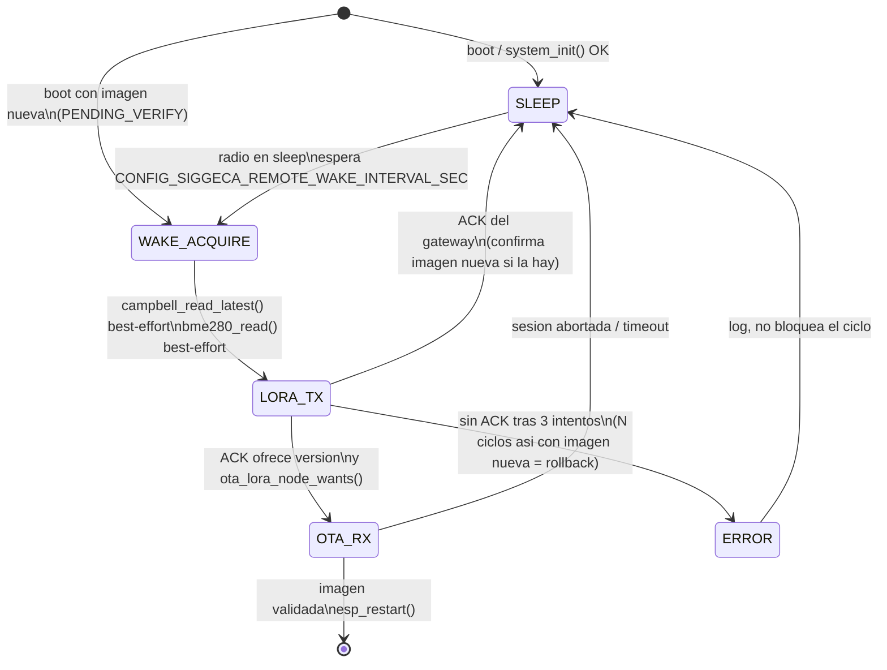

# Máquinas de estado

Diagramas en Mermaid (renderizan directo en GitHub) de las dos FSM del
firmware. Se generan a mano a partir del código -- si cambia
`gateway_fsm.c`/`remote_fsm.c`, actualizar este archivo en el mismo commit
para que no se desincronicen (el mismo problema de drift documentado en
`node_config.h` para la config de sitio).

## Gateway (`gateway/main/src/gateway_fsm.c`)

Notas:
- `execute_ota()` **siempre** reinicia el equipo (éxito o reintentos
  agotados), así que la FSM no vuelve a `SLEEP` sola -- el próximo ciclo
  arranca en el boot siguiente. Por eso `OTA_CHECK` y `ERROR` van a `[*]`
  en vez de tener una transición saliente real.
- `NODE_RELAY_ON_MS`/`NODE_RELAY_OFF_MS` salen de Kconfig
  (`node_config.h`), no están hardcodeados en la FSM.
- La recepción LoRa **no** es parte de esta FSM: la tarea `lora_rx_task`
  (prioridad alta, dueña del radio) escucha siempre, contesta el ACK a cada
  telemetría del remoto y la guarda en un buffer en memoria RTC (sobrevive al
  `esp_restart()` del final del ciclo). La FSM solo vacía ese buffer a
  InfluxDB cuando hay wifi: en `ANTENNA_ON_WIFI_CONNECT` y de nuevo en
  `OTA_WARMUP`, para que lo recibido durante la ventana OFF no espere un
  ciclo entero.
- `ANTENNA_OFF` deja de ofrecer OTA por LoRa y espera a que termine una sesión hacia el
  remoto (`ota_lora_gw_busy()`), como máximo `SIGGECA_LORA_OTA_MAX_DEFER_MIN`.
  Si no esperara, el reinicio de `OTA_CHECK` la cortaría a la mitad.
- `remote_image_fetch()` baja la imagen del remoto (`SIGGECA_REMOTE_OTA_URL`)
  a la partición `lora_img` antes de la OTA propia del gateway. Ver
  `docs/LORA.md`.

## Nodo remoto (`remote/main/src/remote_fsm.c`)

Notas:
- A diferencia del gateway, acá `ERROR` **no** reinicia el equipo -- vuelve
  a dormir y reintenta en el próximo ciclo (mismo criterio que "si no hay
  conexión, apagar igual" de la campaña anterior).
- `bme280_read()` y `campbell_read_latest()` son best-effort: si fallan,
  la trama sale igual con el flag correspondiente en 0. Antes un fallo del
  Campbell salteaba el ciclo; ahora el gateway sigue viendo al nodo vivo y
  una OTA puede llegar a arreglar justamente el driver del Campbell.
- `OTA_RX` puede durar ~15 min (imagen de ~300 KB a SF7) dentro de un solo
  estado: `ota_lora_node_run()` hace `wdt_hw_kick()` en cada paquete.
- Imagen nueva (`PENDING_VERIFY`): el primer ciclo corre enseguida (sin
  dormir antes), la imagen se confirma con el primer ACK del gateway y hace
  rollback tras `SIGGECA_REMOTE_ROLLBACK_AFTER_FAILS` ciclos sin ACK. Desde
  una imagen sin confirmar no se aceptan ofertas de OTA. Ver `docs/LORA.md`.
- `SLEEP` es un `vTaskDelay`, no `esp_deep_sleep_start()` -- ver el
  comentario en `remote_fsm.h` sobre por qué (todavía no hace falta el
  ahorro de energía real de un deep sleep).
